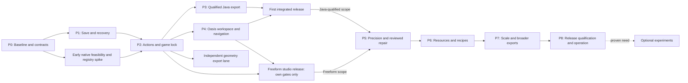

# LFS Block Studio — end-to-end upgrade delivery plan

Planning refresh: **2026-11-01**. Status: **PLAN READY; P0–P8 IMPLEMENTATION PARTIAL; RELEASE NOT_ACCEPTED**. This document plans the complete upgrade and the return to AI Studio. It is not a claim that generated code, passing tests or a diagram establish a finished platform.

User execution decision, 2026-11-01: **skip native Minecraft/WorldEdit test runs**. Continue independent implementation; keep native qualification NOT_RUN and experimental labels. See NATIVE_TEST_DECISION.md.

## Product contract and scope

Create a joyful, fast building studio that is simple on first use and deep when needed: a calm Oasis workspace, precise building, useful local resources, readable commands/recipes, reliable recovery and honest exports. Retain React, Vite and Three.js unless measured constraints invalidate that choice. Remove duplicate controls and authorities before adding frameworks.

The confirmed main toggle is **Game compatibility lock**. Its first target is **Minecraft Java Edition / WorldEdit `.schem`**. It constrains actual placed content, operations and target export across every editing route. Theme, navigation preset, density, layout and optional Simple/Advanced presentation are independent preferences. An unused Freeform library asset can remain stored, but cannot bypass locked placement/export. The lock does not promise compatibility with every Minecraft version or arbitrary freeform geometry.

The first integrated release is one coherent journey: **open a starter → choose controls/target → build → find/select/inspect → correct/Undo → save → reopen → review/export → paste successfully in the declared native target**. It includes the essential Oasis shell, a useful admitted palette and accessible alternatives. It does not require every later power feature.

## Source truth before delivery

| Evidence state | Verified observation / consequence |
|---|---|
| Preserved local upgrade tree | Branch `codex/studio-upgrades`, unchanged base/HEAD `f2de5949594202e57fda9dc38cea7bf3634825ab` plus manifest-identified uncommitted work. Current frozen local assets `index-ChU-Vftz.js` / `index-N7aGP9Kv.css`. |
| Last verified GitHub main | `2392861a75db96a659d564f59ada9da8922b6fe6`, direct child of f2de594: one commit/40 paths.35 incoming text files are blob-verified/preserved; selected window/selection ports adapted. Not refreshed for the current local resource-kit slice. Recheck main/AI Studio before convergence. |
| Current local evidence | 395 domain tests / 31 files, type/build and 135 actual App cases on final assets; 107 current persistence/recovery harness cases actually reran on stable source. Resource18 adds complete reviewed kit/library/placement/package workflows; capability-specific limits remain. |
| Earlier candidate evidence | CP34 window/selection, BFhf1rk6 Java 8, D2 compatibility 15/navigation 9/catalogue 6 and older receipts retain their identities. Failures remain preserved. |
| Not established | A merged local/upstream candidate, native paste AND save/reload AND export-back, complete mutation-route coverage, full accessibility/device journeys, hardware capacity, providers and release/update/rollback. |

**Source convergence remains open.** Preserve both trees and current AI Studio edits. Selected window/selection ports and a new local Oasis menu are implemented; status is PARTIAL_SOURCE_INTEGRATION. Do not discard the upgrade contracts to take main wholesale. UPSTREAM_RECONCILIATION.md lists overlap and acceptance. No Git merge, native installation, provider operation, upload or deployment occurred.

The current four-state Java profile (air, stone, cobblestone, oak planks) is a **qualification spike**. It is not a sufficiently useful final creative palette. Choose a representative attractive build and a coherent starter palette; a proposed first planning range is 16–32 simple full-block states, narrowed or expanded by actual task usefulness and native results. This is not current support. Admit each added state with native evidence; directional/multipart blocks follow only with state-aware fixtures. Supported profiles are versioned products, not a name-only dropdown.

## Release sequence and decision gates

| Phase | Delivered experience | Required work and exit gate |
|---|---|---|
| **P0 — converge and measure** | A known, restorable starting point | Reconcile GitHub/AI Studio/local edits; capture source; inspect incoming diagnostics; agree devices, fixtures and baseline. **G0:** identifiable candidate and recovery readback. |
| **P1 — trust the project** | Save, reopen, copy and recover complete work | Finish persistence lifecycle, quota/two-tab handling, retention pins and wider load/history/record/rollback qualification. **G1:** no data loss, false saved state or overwrite in failure fixtures. |
| **P2 — make every edit consistent** | Pointer, forms, commands and tools obey one history and game lock | Preserve the mounted session; complete route/effect/source-token coverage and target transitions. **G2:** zero bypasses or partial composite edits across every exposed route. |
| **P3 — qualify Java export** | A reviewed, traceable `.schem` accepted by the actual target | Keep typed binary download; useful palette; independent readback; native paste, persisted save/reload and export-back. **G3:** zero unexplained differences in the declared suite. |
| **P4 — deliver the Oasis studio** | Calm menus, excellent navigation and accessible comfort | Stable canvas, search/menu, scene list, one inspector, resource drawer, themes, independent sizing and qualified presets. **G4:** complete core tasks with no accidental edits and usable keyboard/single-pointer paths. |
| **P5 — add professional precision** | Snap, measure, align, array, inspect and repair confidently | Exact numeric/list alternatives; slices/views; previewed repair; reviewed conversion-as-copy. **G5:** equivalent results, stale Apply rejection and complete rollback. |
| **P6 — deepen resources and automation** | Portable kits/prefabs and commands/recipes speed real work | One admitted offline kit first; provenance; bounded language; preview/Apply/one Undo; lazy editor only if useful. **G6:** offline closure and atomic/cancellable jobs. |
| **P7 — qualify scale and geometry export** | Larger useful scenes and faithful GLB/other outputs | Measure actual bottlenecks; incremental render/disposal; bounded jobs; independent geometry consumer. **G7:** named workload/device budgets and correct outputs. |
| **P8 — consolidate and hand off** | Updates, offline return, rollback and continued development are repeatable | Exact-candidate regression, user/device/native journeys, update/recovery drills, supported matrix and AI Studio handoff. **G8:** all gates for the advertised release scope pass. |

P1/P2 are the critical foundation. P3 and P4 may advance independently once their shared contracts are stable. Narrow performance fixes and native feasibility begin early. Freeform precision/resources/GLB work need not wait for unavailable Minecraft access; a Freeform release must state its scope and pass its own gates. The Java-integrated release remains held until G3 passes. Gates are capability-specific; no average score overrides data loss, an export mismatch or an inaccessible core task.

## The interface we are building toward

- **Stable central canvas.** A small header exposes project/save/Undo and target/lock state. Search and one contextual inspector reveal deeper options. Resource and command drawers open on demand. Existing tools remain reachable while duplicate panels are retired incrementally.
- **Several discoverable navigation paths.** Orbit, Pan and Fly; screen/ground-plane pan; working-point zoom; frame selected/all; Home/Previous; orthographic faces; camera rescue; visible step controls. Qualify Studio, Minecraft-style, Blender/CAD-style, Trackpad, Touch/Pen and Custom presets one at a time. Do not advertise untested hardware support.
- **Independent comfort controls.** Text, hit areas, density, panel width and outlines; camera sensitivity/speed; render resolution/shadows; reduced motion and sound. Layout/theme/quality never changes project contents, edit history or exported semantics. Fixed layouts precede arbitrary docking.
- **Actual Oasis resources.** Apply the captured LDS token JSON/CSS and SolarpunkIcon source, keeping notices and hashes. Themes: evergreen-dark, evergreen-light, high-contrast, calm. Scope chrome styles; one host owns theme selection; authored materials remain separate.
- **Convenience with visible consequences.** Favorites/recent assets, eyedropper, deterministic repeat-last, exact fields and nudges, meaningful disabled reasons, progress/cancel, named views/checkpoints, project copies, block bills and optional starter challenges. No account or compulsory tutorial before useful local work.
- **Depth through the same operations.** Forms, commands, recipes, prefab changes and optional AI produce validated proposals. They do not create another world, serializer, history stack or permission path.

Accessibility is an editing capability: scene/list/numeric routes, visible focus, useful announcements, non-color status, no-drag single-pointer alternatives and complete keyboard tasks. Keyboard support alone does not satisfy the non-drag pointer requirement. Verify surrounding UI at 200% text scaling and 320-CSS-pixel-equivalent reflow; test actual assistive/hardware pairings before claims. See [W3C dragging guidance](https://www.w3.org/WAI/WCAG22/Understanding/dragging-movements.html) and the detailed experience spec.

## Auto-resolve policy

| Situation | Response |
|---|---|
| Off-screen panel, lost camera, enabled adaptive display quality | Reversible interface maintenance; explain it and allow reversal. No build/history changes. |
| Off-grid cells, overlap, missing references, material replacement, ordinary repair | Show exact affected objects/counts and before/after changes/losses; source-bound preview; Apply once; one atomic Undo. |
| Compatible game-lock toggle with unchanged mappings/content | Explain history consequence; durable predecessor checkpoint and new history epoch. Prior state restores as a separate project. |
| New mapping/version or incompatible geometry conversion | Reviewed separate copy, verified before activation; preserve the original. No unimplemented generic converter promise. |
| Corrupt/unknown data, ambiguous mapping, cloud conflict, uncertain outcome | Preserve the original; stop the dependent action with an actionable explanation. No guessed substitutions, silent deletion or automatic unlock. |

## Immediate work queue for AI Studio

1. **Converge source and freeze a candidate.** Preserve local and upstream/AI Studio snapshots; review the 40-path delta and contract overlaps. Run baseline/affected checks on the resulting source. Inspect the incoming self-auditor separately from its status labels.
2. **Close remaining editing/recovery gaps.** Preserve the qualified direct brush/symmetry path and its source/effect/history rules; finish other cached/async/composite routes, whole-stroke grouping, unknown-policy recovery, retention/checkpoint pins, named-copy discovery and broader quota/two-tab/update/rollback qualification. See BRUSH_MIRROR_CONTRACT.md and HISTORY_CAPACITY_CONTRACT.md.
3. **Continue P4 beyond the menu and contextual properties.** Search, scene discovery, reviewed cell edits and recipes, draft recovery, local naming and shared Oasis appearance have scoped App evidence. Consolidate the remaining ribbon/panels/resource drawer and studio-wide comfort/outline/render controls, then qualify presets/accessibility/first use. Preserve canvas, content, history and exports. See CELL_INSPECTOR_CONTRACT.md.
4. **Continue P3 without undoing working export.** Retain source-bound review/cancel/download/report; expand App edge cases and a useful candidate palette. Native runs are skipped by user. Keep native qualification and dependent release claims open; do not request an installation or run the game.
5. **Run an integrated pilot, then complete P5–P8.** First-build/recovery/lock/export tasks precede precision/repair, portable kits/recipes, measured scale and consolidated release. Reopen earlier gates when schema, input, target or export semantics change.

This is gate-based planning. Relative complexity is recorded in the detailed packages below; calendar commitments require actual implementation capacity and measured accepted-slice throughput. Quality and preserved work take precedence over an invented deadline.

## Tool and resource strategy

Use existing native/browser capabilities first. Every new dependency must solve an observed problem, meet the requested **MIT or Unlicense** terms at the exact distributed package and retain notices. A public repository with no license is not the Unlicense. Root license checks are not transitive/package admission.

| Need | Candidate / decision | Evidence and boundary |
|---|---|---|
| Menu/dialog/focus primitives | Selective Radix primitives if native/current controls cannot meet the tasks | [MIT source](https://github.com/radix-ui/primitives/blob/main/LICENSE), [official docs](https://www.radix-ui.com/primitives/docs/overview/introduction). Styling and accessibility qualification remain ours. |
| Searchable actions | cmdk if it improves the shared command registry presentation | [Source/download](https://github.com/dip/cmdk), [MIT license](https://github.com/dip/cmdk/blob/main/LICENSE.md). Never authoring authority. |
| Simple resizable panels | Native CSS first; react-resizable-panels if keyboard resizing/recovery needs it | [Source/download](https://github.com/bvaughn/react-resizable-panels), [MIT license](https://github.com/bvaughn/react-resizable-panels/blob/main/LICENSE.md). No full docking framework initially. |
| Portable ZIP kits | Existing capabilities first; fflate if bounded ZIP support is needed | [Source/download](https://github.com/101arrowz/fflate), [MIT license](https://github.com/101arrowz/fflate/blob/master/LICENSE). Enforce expanded limits/path policy outside the codec. |
| Commands editor | Lazy CodeMirror candidate only after parser/diagnostics contract | Historical MIT mirror is archived; current upstream distribution access/admission remains open. Existing text area can deliver the first recipe workflow. |
| State/history/storage/NBT | Keep existing session/store/encoder contracts unless a measured defect justifies replacement | No extra state store, history middleware or serializer merely to enlarge the stack. |
| Resources | One original or exact verified CC0 kit before general marketplace intake | Asset rights, original bytes, units, texture closure and offline packaging checked per artifact. |
| Advanced docking/graphs/collaboration/WebGPU | Bounded later experiments | Admit only with a useful task, fallback, license review and measurable benefit. |

Radix, cmdk, panels and fflate root licenses were refreshed 2026-11-01; no package was installed. A failed panels LICENSE-path read was corrected to LICENSE.md and retained in research evidence. WorldEdit is an external GPL native validation tool, not an MIT app dependency. Oasis resources are user-directed first-party **proprietary source-available** material; preserve their notices and local reuse scope. Theme reuse does not require importing Oasis identity/server architecture. No external hosting or publishing is assumed.

## Measures, alternatives and revision boundaries

| Claim or choice | Measure / falsification / action |
|---|---|
| Existing stack can support the studio | Benchmark small, heterogeneous 10k and sparse fixtures, then a bounded 100k stress experiment on named hardware. If correctness/capacity cannot be achieved after bounded fixes, compare a replacement with a migration path. Counts are not supported capacity. |
| More powerful UI is easier to use | Pilot unfamiliar and experienced builders separately on the same tasks; record assistance, errors and completion times. Revise/defer controls that increase friction without useful benefit. |
| Java output is clean for its declared profile | Independent downloaded-file comparison plus native paste, save/reload and export-back. Any unexplained mismatch holds that exporter/profile; source/tests alone cannot clear it. |
| Auto-resolve improves trust | Verify exact previews, cancellation, stale-result rejection and recovery. Any silent authored change or lost original invalidates automatic application. |
| Local-first reduces burden | Core editing/validation/backup works offline without provider credentials. Keep AI/cloud optional; admit provider work only with explicit data controls, bounded jobs, cost limits and conflict handling. |

**Facts/observations:** confirmed target, source identities and receipt scopes above. **Assumptions:** browser-first, account-free useful editing, one useful profile/palette before broad coverage. **Recommendations:** retain one authored authority, converge source first, ship complete journeys and progressive depth. **Estimates:** relative complexity and proposed performance/pilot targets only, unmeasured until P0/pilot. **Confidence:** high in the dependency order; medium in effort and native breadth until convergence and native tasks run.

Review each slice across engineering (one maintainable authority), quality (reproducible semantics), operations (recoverable jobs/updates), security (bounded untrusted/provider paths), users (less task friction) and cost (local determinism before ongoing services). Preserve failures and unrun checks. The detailed P0–P8 contract below supplies fixtures, rollback and stop conditions; IMPLEMENTATION_STATUS.md supplies current evidence.

---

## 1. Outcome and scope

Build an enjoyable, local-first creative studio that supports quick block building and precise professional workflows without making everyone operate a complicated IDE. Preserve React, Vite and Three.js. Reuse existing features, remove duplicate authorities and repair misleading behaviour before adding more mechanisms.

The first integrated release must let someone open a project, navigate comfortably, build through pointer or accessible controls, undo, save/reopen, select a qualified Java profile, enable the lock, and export a schematic that has been imported successfully into the pinned game/WorldEdit environment. It includes a focused Oasis workspace, not every advanced feature in this plan.

### Product outcomes

| Journey | Intended end state | Main delivery gates |
|---|---|---|
| First useful build | Open a starter, choose controls, place/erase, pan/frame, undo, save and reopen without a tutorial dependency | G1, G2, G4 |
| Clean game export | Choose an exact profile, see eligible blocks/tools, validate and export, import/paste with expected blocks and origin | G2, G3 |
| Precise accessible editing | Select by canvas or list, enter coordinates, inspect a floor, repeat a pattern, get equivalent results | G4, G5 |
| Resource and command depth | Import a vetted local kit, manage prefabs, preview a bounded recipe, commit once and undo once | G5, G6 |
| Recovery | Interrupt a save/job, reopen or restore a copy, understand which revision survived and what is unsaved | G1 through G8 |
| Large-world work | Navigate/edit/export within published device/workload limits, with progress and cancellation where needed | G7, G8 |

Keep freeform meshes, custom micro-voxel blocks and arbitrary transforms available in Freeform projects. They do not automatically become Minecraft-compatible content. A separate appearance or workspace-density setting does not replace the game lock.

### Evidence interpretation

The executive brief and `IMPLEMENTATION_STATUS.md` distinguish current inspected source, candidate-specific recorded tests, unfinished candidates and unqualified runtime behavior. The original source audit remains useful at its pinned revision; it is not a live deployment audit. P0 hardware measurements, complete application accessibility and native game acceptance remain open. The current status includes frozen-candidate receipts with distinct scopes. The original planning refresh changed documentation only; subsequent local implementation slices are recorded in IMPLEMENTATION_STATUS.md and their candidate-bound receipts. Upstream 2392861 has not been merged or runtime-qualified here; a future convergence candidate needs new checks.

## 2. Delivery strategy and dependencies

Use thin vertical slices: each combines user-visible behaviour, data/validation, tests, errors and recovery. An isolated menu redesign is not a release, and a broad rewrite is not a prerequisite.

Measurement and accessibility start in P0 and continue throughout. Narrow rendering fixes may move earlier if a measured issue blocks a current slice. The diagram puts final scale qualification late, not all performance work. Lightweight shell/input prototypes may run alongside P1; production integration waits for the shared action contract. P3 and P4 can proceed independently after P2. Geometry/GLB repair can also start after P1/P2; it need not wait for resources, CodeMirror, native Java tests or rendering optimization. P7 consolidates its qualification and capacity evidence. Native access is not a blanket dependency for Freeform precision, resources or faithful geometry export: these may progress against their own accepted gates. The full Java-integrated release remains held until G3 passes; a Freeform-only release must state that boundary clearly.

| Release bundle | User value | Required gates | Explicit limit |
|---|---|---|---|
| Foundation preview | Existing editing becomes recoverable and bounded | G0, G1 and P2.0–P2.2 acceptance | Historical foundation-preview scope only; the newer experimental lock is not accepted for release |
| Freeform studio release, if native is held | Recoverable Freeform building, coherent accessible controls/menu and project backup | G0, G1, relevant G2 routes, G4 and release checks | Java native compatibility/export remains visibly unqualified; no silent game-lock promise |
| First integrated release | Safe local build, coherent controls/menu, qualified Java subset and `.schem` export | G0–G4 plus the release checks in §11 | Only the declared game/device/block matrix |
| Precision release | Orthographic editing, selection tools, reviewed repair and accessible task depth | G5 plus affected prior gates for the advertised scope; G3 only for exposed Java compatibility/export | No silent changes to geometry or profile |
| Resource/automation release | Curated assets, prefabs and deterministic recipes | G6 and affected earlier gates | No arbitrary script execution |
| Scale/export release | Measured larger scenes and tested geometry export | G7, G8 and affected earlier gates | Limits remain device/profile specific |

One integrator owns the shared document/action contracts and resolves cross-slice conflicts. Independent contributors can implement isolated adapters, fixtures and UI components against those contracts. No one changes shared schema/history semantics without updating consumers and migration tests. This is coordination, not a requirement for separate teams or services.

## 3. Architecture decisions to settle before feature growth

### One authored document, separate preferences

Define a versioned `ProjectDocument` that preserves stable project/content IDs, monotonic revision, definitions, game-cell states, custom objects, asset references, materials, prefabs, necessary world metadata, target identity and lock state. Runtime Three objects, credentials and transient presence do not belong in it. Device controls, UI scale, rendering quality and layouts live in a separately versioned `WorkspacePreferences`; optional named project views can be explicit document metadata.

Game cells and Freeform objects need distinct semantic contracts, derived from one authored world. The current mapper projects canonical Java cells from the existing document and explicit captured-definition bindings; do not create a second mutable world or duplicate undo/store authority. For game cells, define canonical integer coordinates, occupied cell, air policy, namespaced block ID and canonical properties. Pin whether stored coordinates mean cell index, render centre or minimum corner; specify axes, signs/directions, rotation/mirror convention and the legacy-to-canonical transform before migrating. Include negative-origin and half-cell anchor fixtures. For freeform geometry, define units, pivot, anchor, occupied footprint and transforms. Derive picking, selection bounds, previews and exports from the same contract so visible position and exported position cannot diverge.

Keep the first extraction small: preserve current authored fields and reserve optional schema sections for future assets/prefabs; do not implement those systems in P1. Plain typed functions/reducers plus existing native storage may suffice. Immer or a subscription store is an option only if it removes measured complexity. Do not create two state stores, two undo stacks or a second document serializer.

### One mutation boundary

Every edit becomes a typed proposal: validate input and limits; resolve affected objects; validate target and edit locks; bind to the source revision; preview when appropriate; commit atomically; record one intentional undo step. Pointer, touch, key, toolbar, command, macro, symmetry, template, prefab update, import, restoration and remote input use this path. Read-only view actions use a separate camera/preference path.

The operation record identifies document ID/revision, session generation, job ID when asynchronous, history epoch, target/profile/registry and validator revisions, affected IDs, exact changes, inverse changes or recoverable predecessor, and work budget. Revision numbers do not go backwards after undo; session generation also prevents a late result matching a reopened project accidentally. Undo and redo are validated mutations, not direct replacement of arbitrary block dictionaries.

For an ordinary edit, commit to the in-memory document atomically, mark it dirty, and acknowledge **locally saved** only after the persistent transaction completes. A persistence failure leaves a recoverable unsaved state with retry/export options; it never claims durable success. For project migration/conversion, finish a new durable copy and verify it before replacing the active pointer.

### Target transitions and history: proposed first-release policy

Changing a game version or converting incompatible Freeform content defaults to **create a converted copy**, leaving the source project intact. Each copy has its own document ID and history. Enabling or disabling the lock on an already compatible document records a recovery checkpoint, invalidates outstanding work and starts a new history epoch after persistence succeeds. Explain this history boundary before the transition. Prior checkpoints remain restorable as a separate project; ordinary Undo never secretly disables the lock or restores unsupported content.

Persist the checkpoint reference, profile/lock state and new history epoch together with an expected source revision/session check. On an intervening edit, reject and recompute the transition; on transaction failure, the previous active document and history remain authoritative. Candidate activation uses the same revision check. Cross-database or localStorage-to-IndexedDB migration needs a recoverable staged/verified/promoted marker because those writes are not one transaction.

This policy trades cross-profile undo convenience for clear invariants. If cross-profile history is later required, design and test it explicitly instead of allowing old snapshots through. Every inverse must still be valid within its epoch. Restore/import first opens a staged candidate and compatibility report; it does not overwrite the active document on parse. An explicit verified project switch may open a separate Freeform project after preserving current work and announcing its policy. This is distinct from mutating a locked project: never strip an imported policy or silently unlock the current project.

### Repair and transition decision table

| Proposed change | Required behavior |
|---|---|
| Reversible interface maintenance | Preference operation; no authored history/content change |
| Ordinary authored repair within the same policy | Show exact changes/losses; one atomic edit and one Undo |
| Compatible lock toggle with unchanged mapping/content | Durable predecessor checkpoint and new history epoch; no cross-epoch ordinary Undo |
| Different mapping/target version or incompatible geometry conversion | Reviewed separate project copy, source preserved |
| Unknown policy, uncertain outcome or missing information | Stop the dependent action; preserve and export original data without downgrade/unlock |

Deterministic snapping and material substitution still change meaning. Reviewed appearance mapping is not lossless appearance export. A project backup does not automatically include all referenced checkpoint revisions or separate resource-source candidates; a retention plan must verify an independently recoverable package before those records could be removed. No cleanup is performed by this plan.

### Work and export lifecycle

Jobs have queued/running/cancelling/cancelled/failed/completed states and bounded inputs, memory estimates and result size. Project/profile switches invalidate pending edits and repairs. A changed repair requires a new preview and fresh Apply. Exports read an immutable snapshot: a previously started export may finish for that clearly identified revision, but its report cannot claim the current project is validated. Retrying a write after an uncertain outcome requires an idempotency/revision contract. Distinguish **dismiss window**, **cancel preparation before commit**, and **undo committed work**. Dismissal does not cancel callbacks. Cancelled preparation publishes nothing; completion after dismissal cannot clear a newer draft or duplicate a write. After commit, report the actual Undo/checkpoint/copy recovery mechanism. An uncertain outcome needs readback/recovery before retry; an indefinitely pending callback must not make recovery inaccessible. Keep local and provider outcomes distinct.

## 4. P0 — establish a recoverable, measurable baseline

**Goal:** know what is actually being changed and how success will be judged. **Depends on:** supplied project access. **Complexity:** small discovery; potentially larger environment repair, reported separately.

- **P0.1 Intake and convergence:** preserve the local upgrade tree and current AI Studio/GitHub tree independently, including manifests and representative project copies. GitHub main was observed at `2392861a75db96a659d564f59ada9da8922b6fe6`, one commit/40 paths after local base `f2de5949594202e57fda9dc38cea7bf3634825ab`. Review overlapping App, viewport, engine, export, storage/provider, windows and server changes before integrating. Keep useful upstream auditor/UX work without reinstating duplicate state, heuristic locked export or unbounded/provider operations. Produce a deliberate merged candidate and rerun affected gates; no reset or blanket source replacement. Recheck remote/AI Studio state at implementation time. See UPSTREAM_RECONCILIATION.md.
- **P0.2 Reproduce:** inspect the actual package manager and lockfile; attempt existing type/build/test tasks in that environment. Record exact results and missing dependencies. Avoid blanket upgrades. Separate baseline failures from introduced failures.
- **P0.3 Inventory:** enumerate mutation/restore routes, save formats, export routes, input owners and visible promises. Mark inaccessible/dormant features; do not remove them without a usage/dependency check. Correct misleading native-export and save labels early.
- **P0.4 Contracts and fixtures:** choose the initial game/importer candidate, reference browser/device tiers, document/coordinate contracts, and workload fixtures. Freeze initial acceptance targets before comparing optimizations.
- **P0.5 Measurement:** record editing latency, camera frame times, cold/reload behaviour and task errors using local diagnostics. Qualify incoming self-tests and issue tracking in isolated fixtures, with bounded work/retention, teardown of interceptors, truthful unknown/default readings and opt-in content capture. An assertion label such as VERIFIED_REMEDIATED is a claim until its actual behavior is independently checked. Diagnostics must not mutate the live project, swallow errors, automatically apply AI patches or send screenshots/commands to a provider. No telemetry upload is needed.

**G0 exit:** starting revision/dirty-file receipt, recovery readback, baseline check ledger, route inventory and initial fixture/device/profile matrix exist. Unresolved runtime access is a named hold, not a fabricated pass. Continue independent design/fixture work while held, but do not declare a runnable baseline.

## 5. P1 — save, migrate and recover without losing work

**Goal:** every later feature can survive reload and failure. **Depends on:** P0. **Complexity:** medium–large; existing formats and migrations determine scope.

- **P1.1 Document schema:** define complete versioned persistence, including custom definitions and references. Accept known legacy formats through explicit adapters. Unsupported future schemas open read-only or fail without touching the source. Preserve raw originals, not just fields the adapter understands.
- **P1.2 Hydration barrier:** load and validate the authoritative active document before edits/autosave. If localStorage and IndexedDB disagree and revisions do not establish order, show a recovery choice; do not invent a last-write winner from unreliable timestamps.
- **P1.3 Durable save:** await transaction completion; serialize saves per document; prevent older async saves from overwriting newer revisions. Expose dirty/saving/saved/failed states and separate backup/cloud states. Remove JSON truncation and ignored failures.
- **P1.4 Migration:** write the candidate under a new schema/project namespace, verify complete readback including assets, then switch the active pointer. Keep the old copy through the rollout. Promote the active pointer with an expected-revision check in one transaction in the target database; retain the prior active state if promotion fails or an intervening edit invalidates the candidate. Use staged/verified/promoted recovery markers for cross-store systems that cannot share a transaction. Re-running migration must not duplicate or overwrite newer work.
- **P1.5 Recovery and concurrency:** named checkpoints, independent downloadable project backup, restore-as-copy preview and duplicate-project experiments. Detect two tabs editing the same project and use a single writer or revision conflict path; do not silently accept last-writer wins.
- **P1.6 Lifecycle:** define storage-capacity errors, retention limits and unavailable/private-storage behaviour. Browser local storage is not an independent backup or an unlimited guarantee. Decouple provider backups from ordinary local saving. Keep cloud writes out of the first delivery path until separately qualified.

**Additional acceptance before wider previews:** preserve actual imported source bytes before normalization. Reject duplicate IDs before constructing maps; absent legacy fields receive documented canonical defaults, while merging current-project settings is an explicit reviewed operation. The strict blueprint/cloud adapters and accepted-original preservation are now implemented with scoped tests; broaden qualification for remaining input routes, resources, provider behavior and later stamping rather than redoing that slice. Publish distinct load, edit/history and export limits. The 32 MiB document allowance now coexists with 16 MiB reversible changed-data history; the sealed predecessor's rejected20 MiB rename is reproduced and fixed. Compact backups and conditional versioned candidate encoding have actual near 32 MiB App evidence, with strict original/readback/CAS and independent byte/damaged-text rescue. See HISTORY_CAPACITY_CONTRACT.md. A changed-data edit above16 MiB still rejects atomically; full validation/cloning remains, and these rejection ceilings are not supported interactive capacity or a heap guarantee. Broaden qualification and offer an explicit recovery-only mode where needed. Qualify prolonged autosave and quota failure. The new key-paginated recovery browser has scoped beyond-100-record evidence; qualify its full-App path and the still-capped named-copy catalogue separately. Pagination is not retention or a cross-tab snapshot. Never evict the sole recoverable original automatically. Pin every policy-checkpoint reference and retained resource-source candidate before pruning. The bounded read-only raw-record rescue now exists for the new namespace; qualify its full-App integration without weakening validation. It explicitly rejects unrepresentable/oversized envelopes and disables lossy text downloads. Browser-owned cloning of one selected record happens before application limits. Preserve this limit, verify actual downloads, and reconcile concurrent recovery discovery; do not promise universal arbitrary-record rescue.

**G1 fixtures:** reload from IndexedDB with localStorage unavailable; valid old projects with custom definitions; aborted/quota-failed writes; out-of-order saves; migration interrupted before/after pointer switch; corrupt/unknown-schema imports; restore and two-tab conflicts. Compare complete canonical documents and asset references, not only block counts. Any loss, false saved state or hydration overwrite blocks the release.

**Rollback:** retain the original namespace and export. A previous app may open only a compatible predecessor; never run old code against an unsupported new schema. New edits after migration stay in the new copy for recovery/forward repair.

## 6. P2 — shared actions and a real game compatibility lock

**Goal:** build intent is consistent across controls and cannot bypass the profile. **Depends on:** P1. **Complexity:** large; split by mutation families.

- **P2.0 Session authority before route migration:** consolidate every authored field into one synchronous session owner, with selection/clipboard as explicit session history and camera/preferences outside it. Separate live edit revision/session/history epoch from durable storage revision/activation. Discard legacy engine histories at the adapter boundary and route toolbar and command undo to the same controller. Validate complete composite changes before publish; effects follow an accepted commit. Keep pre-allocation/pre-loop bounds even when publication is validated.
- **P2.0a Persistence handshake:** read complete authoritative content synchronously; acquire replacement exclusion before asynchronous work; install a verified replacement and rotate the session only after successful activation. Ordinary save acknowledgements advance durable identity without replacing newer edits or resetting live history. Releasing an exclusion must not reopen a read-only/unmounted session. Explicit removal of optional authored fields must survive capture and reload.
- **P2.0b Controller acceptance:** test composite setters as one undo, rejected/no-op effects, edit→undo ABA, session reopen, subscriber/effect reentrancy, async continuation containment, selection/clipboard integrity and history budgets that preserve both predecessor and future inverse. A draft module's import success is insufficient. Test the real App/controller/persistence combination before proceeding to the lock.
- **P2.1 Extract first action slice:** place, erase, paint and one bounded region action with shared parameter validation, canonical coordinates, edit locks, atomic history and deterministic preview/execution. Add a regression fixture before migrating the next family.
- **P2.2 Migrate all routes:** selection/clipboard, symmetry, volume brushes, templates/reset, blueprints/workshop, macros/copilot, import/recovery and remote replacements. Each route is migrated or visibly unavailable for the locked profile. Keep an explicit route-to-test table.
- **P2.3 Profile artifact:** pin game edition/version, actual game DataVersion, format/version, registry hash, mapping revision, coordinate/origin rules, block/state subset, dimensions/volume limits, and explicit entity/biome/block-entity policies. An unknown value remains unsupported. A protocol version is not DataVersion.
- **P2.3a Persist policy explicitly:** add typed profile identity, registry/mapping/validator revisions, lock state and checkpoint reference to the versioned document schema and migration contract. Opaque extensions are not enforcement authority. Persist checkpoint/profile/epoch together, with stale-candidate and crash/readback fixtures, before enabling activation in the UI. Give same-project policy transition its own store operation and qualification: existing restore-copy promotion rejects reusing an existing document ID. Fail before checkpoint creation, during verification/commit and after commit before UI acknowledgement; reopen must see a complete old or complete new policy. Test competing tabs, edit→undo ABA and stale recipes. Unknown policy versions must not silently reopen unlocked.
- **P2.4 Compatibility UI:** target selector, persistent lock indicator, eligible resource list, operation-disabled reasons and an issue report grouped by unsupported content. Existing invalid builds are analyzed before lock activation. Never substitute stone or drop content silently. Ship the minimal explicit mapping and eligibility review here. The first release may reject unsupported geometry and offer continued Freeform editing or a valid starter. P5 supplies reviewed conversion-as-copy and richer repair; do not imply an unimplemented converter exists. Bind reviewed changes and losses to an exact immutable reviewed proposal plus current session/revision/epoch/profile identity (a stable digest may supplement it). Recipes now use an explicit preview-and-Apply workspace with per-step admission; preserve this source-bound path while completing other mutation families.
- **P2.5 Transition/history contract:** implement §3, including changed-profile invalidation, recovery copies, redo validation and rejection of stale results. Hidden/isolate state affects viewing; object edit locks govern edits; neither silently excludes content from export.

**G2 fixtures:** every route that changes the current locked build attempts a forbidden block/property/transform and rejects without partial mutation; explicit restore-as-copy/project switching separately preserves current work and the incoming policy, identifies the new project/target and cannot become a same-project unlock bypass; importing an unused unsupported library resource may succeed, while its attempted placement must reject; valid operations match across pointer/form/command paths; NaN/infinity, invalid IDs, huge sparse bounds and unbounded counts reject before allocation; switching target during a preview rejects stale Apply; undo/redo across lock changes cannot bypass the chosen history policy. Explicitly test unlock → edit a mapped definition or introduce an unsupported transform → failed relock: preserve the unlocked project, fixed bindings and history. Seed and execute actual Undo and Redo payloads before/after rejected edits and transitions; enabled buttons alone do not prove history integrity.

**Rollback:** retain old UI adapters only while they call the new commit boundary. A feature flag must not reactivate an unvalidated write path. If coverage is incomplete, limit the exposed feature/profile instead of labelling the lock complete.

## 7. P3 — qualify the first native Java schematic workflow

**Goal:** exported builds mean what the editor promises in the selected target. **Depends on:** P2, resolved registry provenance and an available native test environment. **Complexity:** large; native evidence is a separate gate.

- **P3.1 Profile qualification spike:** select one exact Minecraft Java release, WorldEdit version/build and test environment; record evidence sources and eligible block subset. The recorded candidate is Java 1.21.1 / DataVersion 3955, WorldEdit 7.3.8 mod artifact WTAFvuRx, Fabric 0.15.11, Java 21 and Sponge 3. It is an isolated, unqualified target; see `JAVA_PROFILE_CANDIDATE.md` for exact source identities and native procedure. Do not select newest packages implicitly. Limit the initial subset to content with understood states and fixtures.
- **P3.2 Serializer:** encode the pinned schema using a verified MIT/Unlicense NBT component if suitable. Define dimensions, palette/state strings, block order/indexing, air/empty cells, compression, origin/offset and DataVersion. Check bounding-box volume and bytes before allocation; sparse far-apart blocks can still imply a huge dense schematic.
- **P3.3 Export workflow:** preserve the now-mounted `studioJavaExport.ts` / `StudioJavaExportModal.tsx` path. Review an immutable exact source capture, explicit bounds/scope and paste anchor, readonly mappings and air cells; acknowledge before encoding. Live source changes, draft edits, cancellation and close/reopen invalidate review/download. Locked Java never mounts legacy heuristic/AI mapping. Actual gzip/NBT downloads and separate SHA-256 reports have scoped App evidence; complete edge-case routes, a useful palette and native acceptance remain. Empty world rejects unresolved bounds; explicit empty selection can export an air-only region. Hidden view state never silently clips export. A downloadable JSON project is labelled as a project, not native `.schem`.
- **P3.4 Independent readback:** reuse the existing test-only structural oracle in `javaSchematic.test.ts` (it does not import production parsing/index helpers), then qualify the actual file downloaded from the integrated editor with independent decoding. Compare canonical coordinates/states, origin and dimensions. Self-round-trip through the same buggy adapter is insufficient.
- **P3.5 Native trial:** load/paste in the pinned Java/WorldEdit environment; compare complete admitted block states, coordinates, offsets and supported payloads, record importer errors and paste flags, and require both a native save/quit/reload comparison and an export-back semantic round-trip. Record post-tick behaviour for stateful content admitted by the profile. Test both non-air and air-overwrite behaviour according to the declared policy. Native libraries used as external validation tools are not automatically admitted as app dependencies.

**G3 fixtures:** asymmetric axis-marker build; negative and nonzero origins; empty/one-cell builds; dense region and large sparse bounds; all admitted palette sizes (multibyte-varint boundaries belong to future generic-codec coverage when the admitted palette can reach them); supported directional state rotations/mirrors; declared air semantics; truncation/corruption; oversized dimensions; unknown IDs/states; explicit rejection of out-of-scope entities/block entities/biomes. Include stairs/slabs or multipart blocks only if the profile actually admits them, then test their complete state relationships.

Acceptance requires zero unexplained semantic differences for the declared suite and successful native import. Serialize/parse passes plus unavailable Minecraft remain **native NOT_RUN**. Publish an experimental export only with that limitation visible; do not describe it as a verified clean export. If native behaviour normalizes states unexpectedly, investigate and narrow the contract rather than hiding the mismatch.

**Rollback:** disable the affected profile/export button, preserve authored content and reports, and keep project backup available. A valid prior serializer is retained only for the exact profile it passed.

## 8. P4 — deliver the first coherent Oasis workspace

**Goal:** a contemporary interface that makes the same core workflow easier with different input methods. **Depends on:** P2 for integration; sketches and interaction tests may begin in P0/P1. **Complexity:** large, split into these independently reviewable increments.

- **P4.1 Input ownership:** one explicit owner per gesture—UI, camera, selection or edit—selected at gesture start. Consolidate hotkeys and conflict handling. Text/IME input, modal focus, pointer cancellation, lost capture, blur and pointer-lock exit clear or suspend the appropriate controls. Closing a menu must not click through into the world.
- **P4.2 Navigation essentials:** refine Orbit and Fly; add visible Pan with screen/ground-plane options, zoom-to-working-point, frame selected/all, Home/Previous, pivot display and recover-camera. Provide visible step-pan, step-orbit and zoom buttons (or equivalent single-tap controls) as well as drag gestures; an explicit Pan tool alone does not satisfy non-drag navigation. Keep camera history separate from edit undo. Offer Studio, Minecraft-style, Blender/CAD-style, Trackpad, Touch/Pen and Custom mappings incrementally; expose only presets whose mappings pass. No shortcut is assigned without checking existing bindings.
- **P4.3 Shell:** stable mounted canvas, one contextual inspector, resource drawer, project menu, searchable action bar, target/lock/report, save state and accessible help. Search opens parameter entry/preview where needed; it does not execute destructive edits by result highlight. Migrate existing commands/tools into this structure instead of creating duplicate handlers. The minimum first-release workspace includes a searchable scene/selection list and local project metadata controls. Its fixed journey is starter → identify target/lock → choose block → place/erase → navigate/frame → find/select/inspect existing content → correct/undo → save/reopen → validate/export. A local project name must not require opening multiplayer. Advanced saved selection sets and grouping can wait until P5.
- **P4.4 Oasis appearance:** apply copied semantic tokens and icon resources with their notices. Support evergreen-dark, evergreen-light, high-contrast and calm. Keep authored world materials separate. Use system fonts initially. Add restrained optional transitions, sound/haptics and reduced-motion handling; preserve instant fallbacks.
- **P4.5 Accessibility and preferences:** keyboard/list/numeric editing for the core journey, single-pointer non-drag alternatives, visible focus, sensible announcements, adjustable text/controls/outlines, touch targets and safe-area layout. Independently control UI, camera and rendering scale. Initial layouts are a small fixed set plus recoverable customization, not a full docking framework. Independently expose text size, control/hit-area size, panel width and selection outline; camera sensitivity/zoom and render quality remain separate. Version and save preferences independently of projects. Verify representative combinations: large text with compact controls, large targets with ordinary text, narrow/reflow layouts, contrast themes and reduced motion. Preference reload retains the choices; layout reset cannot alter content/history or exported semantics.
- **P4.6 First-use and convenience:** optional short tour, a small valid starter per admitted profile, live controls hint, favourites/recent assets, repeat-last where deterministic, recent projects and understandable disabled-action reasons. No account requirement or compulsory tutorial before editing.

**G4 tests:** orbit/pan/fly/frame/menu/text sequences produce zero unintended world edits; focus returns correctly; remapping conflict resolution persists; layout/theme/quality changes preserve the canvas, document/history and export results. Complete the core journey by keyboard, declared screen-reader/browser pairing and single-pointer alternatives. Frame, inspect and return using clicks/taps alone, without dragging, wheel input, multi-touch or held modifier chords. Include toggling the lock, understanding the Undo boundary and restoring a prior checkpoint as a separate project in the usability/recovery tasks. Test real touch/pen hardware before advertising its support; pressure-field support alone does not prove palm rejection.

For ordinary controls, target at least 36px desktop and 48px coarse-pointer hit areas in both dimensions where applicable, with spacing checks. These are product targets. Test 200% text scaling and 320-CSS-pixel-equivalent/400% browser zoom for surrounding UI, all four themes, forced colours/reduced motion and unobscured focus. W3C's dragging criterion requires a non-drag single-pointer alternative separately from keyboard access; a canvas exception does not excuse inaccessible menus. See §15 for sources and the detailed experience spec.

**Rollback:** switch to the prior shell adapter while retaining the domain boundary and data schema. Preferences can reset separately; resetting a layout must not reset a world. Do not reintroduce conflicting hotkeys to preserve visual familiarity.

## 9. P5–P7 — professional depth and measured scale

### P5 — precision, inspection and reviewed repair

**Depends on:** accepted P2/P4 behavior for the advertised scope. Freeform precision may ship after the Freeform studio release while native G3 is held; Java-specific transforms/conversion/export remain gated by the appropriate G2/G3 evidence. **Complexity:** large; admit tools one family at a time.

- **P5.1 Projection and inspection:** real orthographic top/front/side, apparent-scale-preserving projection switch, named views/bookmarks, floor stepping, section/cutaway and ghosted surroundings. Clipping/hiding is view-only unless export scope is separately selected.
- **P5.2 Precision and selection:** grid/workplane/face/anchor snap with visible candidate, axis constraints, numeric offsets/pivots, measure/align/distribute, connected/same-state selection, saved selection sets, overlap cycling, visible-only/select-through and hide/isolate/edit-lock. Numeric/list controls remain equivalent alternatives.
- **P5.3 Repeatable tools:** arrays, mirror, replace and bounded region recipes; show exact affected count and collision policy. A simplified preview must state its simplification. State-aware Minecraft transforms update legal properties; geometric rotation alone is insufficient.
- **P5.4 Repair panel:** structured diagnostics with object links, issue grouping and three levels: reversible UI maintenance; reviewed authored-content changes; unresolved/ambiguous cases that stop. Preserve originals, show substitutions/losses and exact changes, invalidate stale plans, commit once and undo once. Detect conflicting repair rules/cycles. Do not automatically delete checkpoints, disable the game lock or overwrite cloud conflicts. Add conversion-as-copy for explicitly named geometry/mapping/version cases: preview exact substitutions/losses, preserve the source, verify the new copy, then activate it. Unsupported cases stay unresolved; ordinary repair Undo and conversion-copy recovery remain distinct.
- **P5.5 Planning aids:** bill of blocks, bounds/origin and layer-by-layer views. Only show stack estimates if verified item rules exist. These aids do not establish survival feasibility, structural safety or gameplay correctness.

**G5:** pointer/numeric/command routes yield identical canonical state; snapping and transforms preserve target validity; hidden content survives full export; each tool has a no-drag/keyboard path; stale or cancelled repair applies nothing; changed repair requires fresh Apply; undo restores definitions and affected objects, not merely a count. Evaluate tool usefulness with the same tasks before/after, not number of controls added.

### P6 — resources, prefabs and bounded commands

**Depends on:** P1/P2 and stable P5 operations. **Complexity:** large; start with one kit and a small recipe shelf.

- **P6.1 Resource intake:** RESOURCE_KIT_CONTRACT.md records implemented block-native studio kit v1: manifest/resources/license/notices, bounded STORE/DEFLATE ZIP, complete definition closure, exact original preservation/rescue, reviewed library import, selective packaging and retained provenance. The original MIT Courtyard starter is the first admitted kit. Finish broader formats and fully qualified offline journeys. Admit a self-contained GLB with embedded textures separately after units/axes/origin/material/file/expanded-byte/count/depth budgets pass; initially reject external URIs. Preserve originals and show missing/altered resources with relink/recovery instead of deletion. Never auto-convert arbitrary meshes to native game blocks. Current offline evidence uses an already-loaded App; PWA cold start/update is separate.
- **P6.2 Prefab basics:** Independent blueprints, honestly limited anchor thumbnails, numeric reviewed placement and selective packaging now exist. Add named anchors and useful parameters/variants. Linked definitions/updates follow only with impact preview, version pinning, missing-reference recovery and detach behavior. Shared-definition changes validate every affected instance against its profile.
- **P6.3 Language:** RECIPE_WORKSPACE_CONTRACT.md records the current native bounded command editor/shelf, per-step validation, exact final impact, cancellation and one source-bound Apply/Undo. `{active}` uses exact Studio `@id` references; this is not a native WorldEdit script export. Preserve this workflow. Continue typed commands and recipes generated from the same schemas as forms, richer completion/diagnostics and parameter presets. Document units, bounds and error semantics. Reject unbounded loops/recursion and arbitrary JavaScript/shell execution.
- **P6.4 Editor UI:** use a lazy-loaded CodeMirror panel only after the parser and diagnostics contract exists. Optional macro recording records approved domain operations, not raw mouse activity or secrets. A recipe has a declared all-or-nothing transaction policy for the first release.
- **P6.5 Review/presentation:** named checkpoints, before/after differences, annotations and clean captures. Preserve a useful current-world reveal under an honest name. Real historical replay is later work requiring recorded operations, schema/version handling and retention limits; screenshots do not constitute editable backups.

**G6:** a packaged project reopens with its assets offline; altered/missing/oversized resources are handled without losing the project; freeform assets cannot bypass the lock; form/command results match; a failed or cancelled recipe makes no partial edit; accepted recipe undoes once; linked updates, if exposed, preview and validate all changed instances. Keep asset-specific fidelity exceptions visible.

### P7 — performance, portable exports and capacity

**Depends on:** P0 measurements, P2 changesets and relevant feature fixtures; work can begin earlier where it removes an observed bottleneck. **Complexity:** medium–large and measurement dependent.

- **P7.1 Ownership first:** repair geometry/material/texture ownership, disposal and cache bounds. Decouple UI/theme changes from full scene rebuilds. Test shared resources are neither leaked nor disposed while still in use.
- **P7.2 Incremental updates:** dirty blocks/chunks, neighbouring material/pattern invalidation, geometry/material families, suitable instancing and stable picking IDs. Use direct occupancy queries for grid content where appropriate; add BVH only for a measured mesh-picking need.
- **P7.3 Jobs and quality:** workers for measured heavy pure work, bounded queues and transfer costs, progress/cancellation/stale-result handling. Balanced/Quality/Low-power affect presentation only. Adaptive changes are optional and disclose themselves; they never simplify the saved/exported build.
- **P7.4 Geometry export lane:** connect a real geometry-producing GLB path to the active UI using the canonical placement/shape contract. Validate units, pivots, scales, rotations, custom shapes/microvoxels and materials in an independent consumer. Optimizers are considered only after unoptimized output is faithful. Existing Godot text/LDraw exports keep explicit limitations until separately qualified.
- **P7.5 Capacity and resilience:** publish workload/device limits, respond to resize/DPI changes, recover graphics context without losing document state, and keep a recovery/export path when rendering cannot resume. Split views require one document and one active input owner, not duplicate editors.

**G7:** compare named fixtures on named device/browser/power settings, including cold/warm runs, p50/p95/worst stalls and errors. Proposed initial targets: ordinary action feedback p95 under 100ms on the supported reference workload; camera frame-time p95 within 16.7ms for a declared 60 FPS desktop tier or 33.3ms for a declared 30 FPS low-power tier. These are unmeasured targets, not universal promises. Qualify scene/search/resource/diagnostic lists and menus on the same declared workload: find an item beyond the first visible results, select/inspect/nudge, undo, change text and target sizing, and restore focus without losing selection. Test keyboard/screen-reader semantics for paged or virtualized results and long labels. A responsive canvas cannot compensate for unusable core controls. Freeze workload and measurement rules in P0; if targets fail, reduce scope, optimize or publish a lower tier explicitly rather than silently moving the goalposts.

Run repeated load/edit/delete/reset/export/dispose cycles with resource counters and memory traces; require a bounded plateau and investigate sustained growth. Use a heterogeneous 10k-block candidate workload and 100k-block stress experiment alongside small and sparse-world cases. Block count alone is inadequate: materials, bounding volume, history, textures and mesh complexity also count. Every optimized renderer/export must preserve canonical content and picking semantics.

## 10. Test matrix and evidence model

Each fixture has an ID, input hash, expected canonical result/error, profile/registry identity and limits. Tests assert behaviour, not implementation shape. A baseline failure stays visible until its exact check is rerun successfully.

| Family | Minimum coverage | Primary gates |
|---|---|---|
| DATA | Legacy envelopes, custom/edited definitions, reference integrity, unknown fields/schema, corruption, quota/abort, interrupted activation, two tabs | G1, G8 |
| EDIT | Each mutation route, invalid/huge inputs, full undo/redo, profile/epoch changes, neighbour/multipart effects | G2, G5, G6 |
| TARGET | Exact admitted states, disallowed IDs/properties/transforms, origin/air/dimensions, independent parse and native paste | G2, G3 |
| INPUT | Mouse/trackpad/touch/pen where claimed, cancellation/capture/blur, modal/text/IME ownership, presets/conflicts | G4, G5 |
| ACCESS | Keyboard, single-pointer alternatives, screen-reader task pairing, zoom/contrast/reduced motion/focus | Every visible slice |
| JOB | Cancel before commit, cancel after commit offering undo, project switch/reopen, stale result, bounded queue, failed retry | G2, G5–G8 |
| ASSET | Offline package closure, original bytes, malformed archives/references, units/textures, prefab version changes | G6, G7 |
| SCALE | Small/dense/sparse/heterogeneous scenes, transparent materials, chunk boundaries, repeated resource cycles, context loss | G4, G7 |
| UPDATE | Offline reopen, app/cache/schema mismatch, stale tabs, upgrade interruption and rollback preserving newer work | G8 and each release |

For usability, start with a proposed small pilot of five unfamiliar and five experienced builders, separate results. Aim for at least four of five in each group to complete the assigned core journey without intervention; every participant should recover a deliberate mistake and understand the target/lock state. Record assistance, errors and completion-time distributions. This is formative discovery, not a population reliability estimate. A small sample does not justify “80% of all users succeed.” Include people who use the relevant assistive methods; a simulated screen reader run is not user research.

For precision tools, compare equal tasks in counterbalanced order; a proposed 20% median time reduction with identical output and no increase in accidental edits is a useful design target, not a release claim today. If a tool adds complexity without benefit, revise or defer it. Correctness and recovery failures block release even when average task time improves.

Store a compact receipt per slice with: candidate revision/diff, dependencies and notices changed, fixture/profile hashes, environment, checks and outputs, failed/unrun checks, known limitations, restoration point and next bounded step. Distinguish **source review**, **document checks**, **automated tests**, **browser/device/accessibility**, **native import**, **merge**, **deployment** and **observed operation**. No one state implies the next.

## 11. P8 — release, migration rollout and continued operation

Apply these release checks to every user-facing bundle, then complete G8 for the consolidated platform. **Depends on:** the gates for exposed features, not every optional experiment.

1. Build an exact candidate with locked dependencies and the intended offline assets/registries. Run relevant regression gates against that candidate, not a previous branch.
2. Rehearse upgrade in disposable copies of representative browser storage: migrate, interrupt, reopen, edit, backup and restore. Budget space for predecessor and candidate; low space must not trigger deletion of the only recoverable source.
3. Exercise app/service-worker updates and older open tabs. Do not force reload during edits; prevent an older app from writing an unsupported schema. Test offline reopen after installation separately from first-ever offline launch.
4. Offer the candidate for local pilot use with explicit supported profiles/devices and disabled experiments. Capture opt-in local diagnostics with useful error IDs, duration, revision and job state; omit authored content and secrets by default. No analytics service is required.
5. Resolve reproducible data loss, lock bypass, native export mismatch, inaccessible core tasks or unsaved-overwrite defects before broad use. A failed optional feature can be disabled without holding unrelated accepted local functionality.
6. Rehearse rollback of app, preferences and data compatibility. Preserve work authored after upgrade; recovery is opening a compatible predecessor as a copy or forward repair, never clearing the user's origin. Rollback of code does not retract already downloaded bad exports—record affected exporter/profile versions and correct the support claim.
7. Produce user-facing release notes, migration/backup guidance, control reference, supported format/profile matrix, known limits and the evidence receipt. Merge/publishing/production migration remain separate authorized actions; this document does not execute them.

**G8 exit:** the selected bundle passes its full critical journeys, update/restore/rollback drills and scoped evidence review. Monitor reported defects and local diagnostics during use; maintain pinned fixtures and rerun affected gates on every schema, registry, exporter, input or dependency change. No timer or monitoring service is created by this plan.

Source-specific release checks: the current service worker activates/claims immediately, deletes differently named origin caches and does not await fetch-response cache writes. Scope deletion to this app; qualify interrupted installation, offline cold reopen, old tabs and app/schema mismatch before claiming reliable offline updates. Do not broaden an unqualified local preview to network access. The existing server listens on all interfaces and its AI mapping route lacks a complete authentication/rate/batch/cost boundary; explicit provider enablement needs those controls, bounded timeouts and data-sharing review. Cloud world snapshots currently omit some complete-project fields and must not be labelled complete backups.

Existing cloud features require a specific containment decision in P0: until their conflict and ownership semantics pass, keep them unavailable in the new local-first flow or stage incoming content as a candidate for explicit comparison. Do not leave an old whole-world subscription silently replacing the guarded local document. Offline work, menus, local validation and backup stay useful without provider credentials. Cloud backup, live collaboration and account deletion are separate capabilities with separate receipts.

## 12. Dependency and resource admission

This is a selection plan, not an install list. New code must meet the user's **MIT or Unlicense** requirement; “no license file” is not the Unlicense and grants no reuse permission. CC0 art is a separate lane. Existing project dependencies and Oasis first-party source have their own terms.

| Need | Preferred starting point | Admission timing |
|---|---|---|
| Documents/storage/actions | Existing TypeScript and native IndexedDB; consider Zod for bounded schemas | P1/P2 only when it simplifies validation |
| Native NBT | NBTify candidate with exact artifact/license review | P3 after schema/profile choice |
| Accessible menus/search | Selected Radix/shadcn components, cmdk; use existing icons where sufficient | P4 after checking React/toolchain fit |
| Resize/layout | Existing layout repair first; selected react-resizable-panels if needed | P4/P5 after keyboard/layout tests |
| Code editing | CodeMirror 6, lazy loaded | P6 after language contract |
| Assets | One explicit CC0 pack from the researched sources | P6 with manifest and import bounds |
| Performance/export | Existing Three facilities first; mesh BVH, glTF Transform/meshoptimizer only if measured | P7 after faithful baseline |
| State/docking/graphs/collaboration | No automatic addition | Separate demonstrated need |

For every admitted artifact record source/download URL, exact version/hash, inspected license, notices, intended use and relevant transitive/plugin/font/data terms. Apply this to existing visible catalogue claims too: local authored presets must not imply they are actual downloaded provider assets. Remove or label illustrative ratings/download counts and unsubstantiated CC0/provider attribution until exact admitted bytes support them. Review install scripts and bundled assets. Keep a reproducible lockfile. Registry rights and Minecraft texture rights are separate from serializer licensing; no Mojang asset distribution is implied. A GPL native game tool used externally for validation does not become an approved MIT application dependency.

Oasis integration uses the supplied token JSON/CSS/icon bytes and scoped adapter with `source_manifest.json` and original notices. These copies include local modifications/untracked content relative to U2 HEAD, so file hashes identify them. They are proprietary source-available, not relicensed MIT. Import theme semantics into this Vite app; do not transplant the Oasis Next.js shell, identity services or governance documents. A future host embedding uses a separately reviewed bounded capability interface.

## 13. Decisions, risks and stop conditions

Decisions labelled “proposed” can proceed as planning assumptions. The implementation owner resolves factual pins from the actual environment before the dependent gate; the user need not answer every technical detail in advance.

| Decision / risk | Proposed policy or owner action | Needed by / invalidation condition |
|---|---|---|
| Exact game/importer/profile | Engineer proposes one supported pair with registry/DataVersion evidence and native fixture plan | P3; unknown identity blocks qualification |
| Registry/asset provenance | Admit only verified selected artifacts or a bounded authored mapping with documented provenance | P2/P3/P6; unresolved rights excludes artifact |
| Device/browser/assistive matrix | Name reference desktop, low-power/touch devices and assistive pairings available for real tests | P0; untested platforms stay unqualified |
| Storage/history retention | Distinguish load/edit/export limits; pin checkpoint references and resource originals; paginate recovery; offer read-only raw rescue for future schemas; never silent eviction of the only recovery copy | P1; insufficient space stops promotion or enters explicit recovery-only mode |
| Profile undo semantics | Proposed epoch boundary and restore-as-copy in §3 | P2; requirement for seamless cross-profile undo triggers redesign |
| Air/origin/block entities | Explicit profile contract; initially exclude unsupported semantic features | P3; unexplained native normalization blocks support |
| Smoothness at scale | Benchmark actual workloads before renderer replacement | P0/P7; persistent budget failure changes supported tier or architecture |
| Cloud replacement and permissions | Isolate unqualified routes; later explicit backup/concurrency/auth work | P0/P2; any raw remote overwrite invalidates lock/recovery claims |
| User workload/complexity | Protect core journey and defer unused controls | Each pilot; higher error rate or inaccessible tasks triggers redesign |
| Runtime/library drift | Recheck exact selected distributions and client capabilities | Each admission/update; new incompatible API/license invalidates old acceptance |

The leading hypothesis is that incremental contracts and adapters produce a better result than replacing the engine. It is supported by the current feature breadth and concrete save/export/input defects. It is falsified if authored Freeform content cannot be preserved, declared admitted target semantics cannot be represented correctly, or measured performance cannot meet the agreed tier after bounded fixes. Deterministic conversion is not necessarily lossless: the current appearance bindings are explicit reviewed substitutions, not a promise to reproduce arbitrary Freeform appearance in Minecraft. In that case, replace the failing boundary with a migration plan; do not assume the entire app must be rewritten.

Across the six perspectives: engineering gets one document/action model; quality gets semantic fixtures and independent native checks; operations gets honest saves and restore drills; security gets bounded inputs and no implicit provider authority; users get predictable controls and reversible edits; cost control gets local execution, curated assets and optional services. There is no subscription-cost estimate until optional providers and actual usage are selected.

Deferred by default: gamepad, collision-aware Walk, split views, WebGPU, general visual graphs, linked-prefab update complexity beyond basic variants, AI execution and live collaboration. Admit an experiment only with a concrete task, named owner, bounded prototype, fallback and measurable benefit. Walk is an editor inspection aid, not Minecraft-physics proof. Arbitrary scripts and automatic publishing remain outside this plan.

## 14. AI Studio execution protocol and first work order

Upload this plan first; add `system_snapshot.md`, `IMPLEMENTATION_STATUS.md`, `AI_STUDIO_HANDOFF.md` and the relevant resource files when needed. This package contains reference documents, Oasis resources, exact receipts and `CURRENT_SOURCE.zip`, a manifest-verified application source/configuration/test capture. It excludes Git metadata, installed dependencies, generated build output, runtime environment files and AI Studio cached media/history. Reconcile the actual receiving source before using it; it is not a full workstation or user-data backup. For implementation, compare the actual AI Studio source with the recorded revision and attach the current changed files as needed. Workstation paths and hyperlinks do not substitute for file attachments. Attachment limits have not been tested. Exclude credentials and unrelated private material.

The receiving AI should:

1. Establish the actual source revision/edits and compare to the snapshot. Read source-local instructions and preserve a recoverable predecessor.
2. Select one bounded work package and list acceptance fixtures before edits. Use existing versions/tooling; do not install the whole shortlist.
3. Implement a small vertical slice, review the diff, run relevant checks and retain failures. Recheck all dependent save/history/profile consumers when a schema or operation changes.
4. Return changed behaviour/files, chosen artifacts/notices, evidence, limitations and the next package. Keep runtime/native/provider checks explicitly NOT_RUN where unavailable.
5. Stop dependent delivery on data loss, lock bypass or unsupported schema writes; continue useful independent investigation. Do not call the entire roadmap complete because generated code or document checks pass.

**Next work order:** converge upstream/AI Studio while preserving resource/recipe/properties/brush/history/backup work and one session/policy/save/export authority. Current evidence is 395 domain tests / 31 files, 135 actual App cases and 107 current persistence/recovery harness cases. Continue P1 lifecycle/pins/named-copy and G2 routes, P4 shell/full accessibility, P5 precision/repair, P6 general assets/linked prefabs/richer language tooling and fully qualified offline journeys, P7 measured scale/faithful geometry and P8 update/rollback/handoff. Native remains NOT_RUN — skipped by user. No phase or release acceptance follows.

**If the receiving source is the original baseline instead:** first reconcile divergence, then follow P0/P1 including hydration, full schema, staged/readback/compare-and-promote, writer fencing and failure-visible recovery. Do not copy later snippets into an older tree without their dependencies. The source revision determines the work order, not the presence of this document.

Subsequent handoffs follow the stable IDs in this document. Record accepted/deferred/blocked packages and exact evidence rather than maintaining a second contradictory roadmap. A small source-backed checklist plus one receipt per slice is sufficient; do not build a project-management system before improving the editor.

## 14A. Execution board, draft lifecycle and release decisions

Use a small delivery board with one integrator and at most two independent implementation lanes. The integrator owns schema, history, target policy and activation; UI and native/export contributors work against the same reviewed contract. Do not let parallel writers redefine shared invariants. Work items move through scoped design, implementation, automated checks, real workflow qualification and acceptance; source completion does not skip later states.

| First work item | Owner role | Concrete output / dependency |
|---|---|---|
| E01 — source convergence | Integrator | Preserve the current resource-kit checkpoint, sealed predecessors and current upstream/AI Studio source; resolve semantics and requalify a deliberate candidate |
| E02 — route and recovery closure | UI + domain engineer, one integrator | Reuse brush 13/App 15/catalogue 6 and exact whole-cell/half-pivot proposals; finish remaining cached/async/effect routes, whole-stroke grouping, future-policy App scenarios, retention pins and measured capacity |
| E03 — reviewed mapping and starter palette | Domain + native/export engineer | Reuse current unit-cell contract; choose useful palette/build, independently validate mappings and native feasibility |
| E04 — reviewed game-lock workflow | Integrator | Finish existing mounted report/approval/eligibility; test durable history boundaries and all routes; preserve mapping-only first-release scope |
| E05A — native export lane | Export engineer | Retain current actual downloaded-file App 10 and historical scoped export UI 13 coverage; extend edge cases/useful palette and pinned native paste/reload/export-back evidence |
| E05B — Oasis experience lane | UI engineer | Fixed responsive layouts, contextual inspector, themes, control presets and accessibility task receipts |
| E06 — integrated pilot | Integrator + representative users | Full end-to-end journey, defect triage, recovery and scoped first-release decision |
| E07 onward | Same roles as needed | P5 precision/repair, P6 general assets/linked prefabs/recipe tooling, P7 scale/geometry exports, P8 consolidated qualification |

### UI draft lifecycle is part of correctness

Every async editor must distinguish the submitted draft, the current draft and the live project revision. A success for an earlier draft may acknowledge that saved version; it must not close, clear, rename or mark a newer draft saved. Close/reopen rotates the draft generation. Rejections keep inputs available with a reason. Repeated submission must not duplicate writes. If authoring is disabled while waiting, explain this accessibly and retain navigation/cancellation appropriate to the operation. A spinner or disabled submit button alone does not guard other editable fields.

Test the actual component and integrated route: submit A; change to B; resolve A success/failure; close/reopen C; resolve A again; verify which draft remains and what was saved. Include geometry, voxels, metadata and local-vs-provider outcomes. Historical failing evidence is `evidence/action-outcomes-known-failure.json`; its scoped draft-close defect is resolved by `evidence/action-outcomes-37.json`. The raw failure remains preserved. Provider and full App workshop behavior require separate evidence.

### Profile changes have an explicit exception to ordinary Undo

Ordinary authored repairs undo once. Enabling/disabling a compatible lock checkpoints the previous policy and starts a new durable history epoch. Version changes or incompatible conversions create a new project copy. Restore a prior checkpoint as a separate project. Do not describe those transitions as a normal Undo entry. Persist typed target/profile/registry/validator identity, lock, checkpoint reference and epoch atomically before exposing the toggle. Opaque extension data is never trusted enforcement policy.

### Pilot decisions and budget discipline

Define the actual first reference desktop/browser and available assistive pairing in E01; add a lower-power tier and physical touch/pen/trackpad lanes only when devices are available. Software-rendered browser checks do not qualify those tiers. Select a representative attractive build and minimum useful palette in E03; four codec states are insufficient evidence of creative usefulness.

Review each accepted slice against six questions: can engineering maintain one authority, can quality reproduce semantic outcomes, can operations recover an interrupted job, are untrusted input/provider boundaries contained, does the user complete the task with less friction, and does ongoing local/service cost stay proportionate? Use local deterministic tools by default. Optional AI/provider work needs explicit user-controlled invocation, cancel/usage limits and useful non-provider alternatives; no token/cost estimate is invented without selected providers and workload.

The release decision is conjunctive: all critical journey gates for its advertised scope must pass. One data-loss, lock-bypass, unexplained native mismatch or inaccessible core task blocks that scope even when average latency improves. A failed optional feature can be withdrawn while unrelated accepted local work proceeds. Revisit the existing-engine strategy only if preservation of authored content, correct declared target semantics or agreed performance remains unattainable after bounded fixes; preserve the migration path before replacing a subsystem.

## 15. Sources and companion documents

- Existing implementation and source locations: `system_snapshot.md`, pinned to [repository commit f2de594](https://github.com/SyrisBruhh42/LFS-Block-Studio/commit/f2de5949594202e57fda9dc38cea7bf3634825ab).
- Product/tool research: `upgrade_blueprint.md` and `experience_upgrade_spec.md`; original upstream/license links remain in the individual reviews.
- Independent delivery reviews: `reviews/delivery-engineering-review.md`, `reviews/delivery-experience-review.md`, `reviews/delivery-reliability-review.md`. These are design inputs, not acceptance results. Some propose complete-profile undo; §3 deliberately selects a visible epoch/copy policy for the first implementation instead. Revisit only with an explicit contract change.
- Native format source: [Sponge schematic v3 specification](https://github.com/SpongePowered/Schematic-Specification/blob/master/versions/schematic-3.md); importer workflow: [WorldEdit clipboard documentation](https://worldedit.enginehub.org/en/latest/usage/clipboard/). These describe format/workflow, not this app's compatibility. Rechecked 2026-11-01; version pinning still belongs to P3.
- Accessibility: [W3C dragging movements](https://www.w3.org/WAI/WCAG22/Understanding/dragging-movements.html), [target size](https://www.w3.org/WAI/WCAG22/Understanding/target-size-minimum.html), [reflow](https://www.w3.org/WAI/WCAG22/Understanding/reflow.html). The experience research contains the broader task guidance. Requirements do not establish implementation compliance.
- Storage: [MDN storage quotas and eviction](https://developer.mozilla.org/en-US/docs/Web/API/Storage_API/Storage_quotas_and_eviction_criteria), [IndexedDB transaction lifecycle/durability](https://developer.mozilla.org/en-US/docs/Web/API/IDBTransaction). Transaction completion is a meaningful local-save boundary, not a guarantee against all power loss, eviction or device loss.

**Completion of this document:** a reviewed roadmap and portable handoff. **Completion of the upgrades:** the exposed release journeys have passed their named source, test, browser/device, recovery and native-import gates on the actual candidate. Merge, publishing and observed operation remain separately evidenced.

Current brush continuation: BRUSH_MIRROR_CONTRACT.md specifies exact cell/half-pivot behavior, IDs/no-op/overlap accounting, negative coordinates, source fences and the exact locked directionless Java mirror rule. Native mouse plus actual project-switch and numeric tool paths are checked. Arbitrary custom-geometry reflection, whole-stroke grouping and complete G2/G4 remain open.
